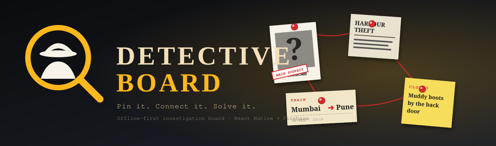
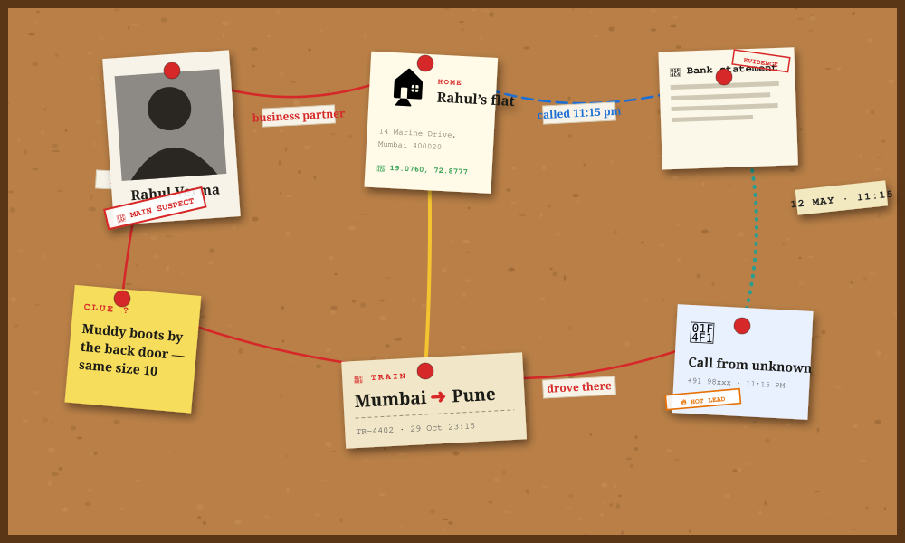

<div align="center">


<a href="https://github.com/anup-kgp"></a>

<p>
  
  
  
</p>

<p>
  <a href="#-about-me">About</a> &nbsp;·&nbsp;
  <a href="#-currently-building">Building</a> &nbsp;·&nbsp;
  <a href="#-tech-stack">Stack</a> &nbsp;·&nbsp;
  <a href="#-open-source-playground">Projects</a> &nbsp;·&nbsp;
  <a href="#-github-stats">Stats</a> &nbsp;·&nbsp;
  <a href="#-lets-work-together">Work with me</a>
</p>

</div>

---

## 👨‍💻 About me

<table>
<tr>
<td width="58%" valign="top">

```ts
const anup = {
  name: "Anup Das",
  role: "Frontend & Mobile Developer",
  location: "India 🇮🇳",
  loves: ["React", "React Native", "Firebase"],
  currentlyLearning: ["MongoDB", "Docker", "RN native modules"],
  motto: "Building digital things that sometimes work",
  status: "Probably fixing a bug I created 5 minutes ago",
};
```

</td>
<td width="42%" align="center" valign="middle">

</td>
</tr>
</table>

- 🚀 I build **websites, dashboards, admin panels and mobile apps**
- 📱 Making React Native apps… and promising myself I'll finish them 😅
- 🔥 **Firebase** is my comfort zone — SQL when data matters, Firestore when life should be easier
- 🤝 Always up for collaborating on interesting projects
- 💬 Ask me about React, Firebase, JavaScript — or why CSS hates me

<br/>

## 🕵️ Currently building

<div align="center">
  
</div>

<br/>

**Detective Board** — a crime-board style investigation app for Android. Pin people, evidence, places and routes on a cork board, tie them together with red thread, and keep the whole case **offline-first** on your phone.

<table>
<tr>
<td width="50%" valign="top">

**🧩 On the board**
- 👤 People with photos, sightings & status marks (*Main suspect*, *Witness*…)
- 📰 Clippings, documents, clues, sticky notes
- 🏠 Places · 🚆 trains, flights & routes · 📱 calls · 💰 payments
- 🧵 Custom threads — colors, styles, labels

</td>
<td width="50%" valign="top">

**🔐 Built for privacy**
- 🔢 PIN, fingerprint & face unlock
- 🎭 **Fake PIN** that opens a harmless decoy board
- 👥 Share a case as *view-only* or *edit* with a unique detective code
- 📄 One-tap **PDF case file** export · 🗺️ free OpenStreetMap maps

</td>
</tr>
</table>

<div align="center">
  
  <br/><br/>
  
  
  
  
  
</div>

<br/>

## 🛠 Tech stack

<table>
<tr><td width="150"><b>🌐 Frontend</b></td><td></td></tr>
<tr><td><b>📱 Mobile</b></td><td> &nbsp;React Native · Expo · bare CLI workflow</td></tr>
<tr><td><b>⚙️ Backend</b></td><td></td></tr>
<tr><td><b>🗄️ Databases</b></td><td> &nbsp;Firestore · Realtime DB · SQL</td></tr>
<tr><td><b>☁️ Cloud</b></td><td></td></tr>
<tr><td><b>🧰 Tools</b></td><td></td></tr>
</table>

<details>
<summary><b>🤖 Also in my toolbox</b></summary>
<br/>

Chrome DevTools · Firebase Console · XAMPP · MySQL Workbench · Android Studio · Cursor · Claude · ChatGPT · GitHub Copilot · REST APIs · Firebase Auth

</details>

<br/>

## 📂 Open-source playground

<div align="center">
<a href="https://github.com/anup-kgp/D-start"></a>
<a href="https://github.com/anup-kgp/DSA-with-Java-2026"></a>
<a href="https://github.com/anup-kgp/UNO"></a>
<a href="https://github.com/anup-kgp/SQL-Practice-"></a>
</div>

<sub>…and plenty more in private repos — client work, dashboards, apps that are "almost finished". 😉</sub>

<br/>

## 📊 GitHub stats

<div align="center">


<br/>

<br/>

</div>

<br/>

## ☕ Developer status

```text
Coding                    ███████████████░░░
Coffee                    ██████████████████
New side-project ideas    ██████████████████
Finishing old projects    ██████████░░░░░░░░
Browser tabs open         ██████████████████  (47)
Sleep                     ░░░░░░░░░░░░░░░░░░
```

<details>
<summary><b>💀 Developer achievements (click to unlock)</b></summary>
<br/>

🏆 Built apps that actually reached production  
🏆 Built apps that are **99% complete**  
🏆 Built apps that have been *"almost finished"* for months  
🏆 Fixed bugs by changing absolutely nothing  
🏆 Spent 6 hours debugging… forgot to save the file  
🏆 Professional at saying: *"I'll optimize it later."*  
⚡ **Fun fact:** I don't abandon projects — I release them as *"Coming Soon."*

</details>

<br/>

## 🤝 Let's work together

<div align="center">

| 🎨 Build | 📱 Ship | 🔧 Fix |
|:--:|:--:|:--:|
| Landing pages · business sites · portfolios | React Native apps · Firebase backends | API integration · UI/UX polish · admin dashboards |

<br/>


<br/><br/>

<a href="https://github.com/anup-kgp"></a>

</div>


